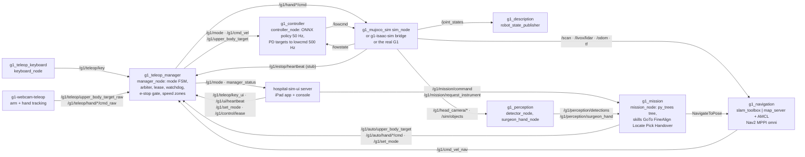

# hospital-sim-ros2: ROS 2 nodes driving the G1

This repository is the ROS 2 Humble side of the hospital G1 project. It holds the `g1_*` packages and the
vendored Unitree messages under `third_party/`. The repository implements the contract in `docs/interfaces.md` of
the master repository (topics, modes, key bindings, policy sidecar). The simulator publishes the low-level topics of
the real G1 (`/lowcmd`, `/lowstate`, `unitree_hg`). The same controller, mode manager and teleop nodes can therefore
point at the real robot later.

The `g1_*` packages are:

- the MuJoCo simulator node
- the ONNX policy controller
- the mode manager
- the keyboard teleop node
- the SLAM and Nav2 configuration
- the perception nodes
- the scrub-nurse mission
- the bringup launch files

At build time and at run time the packages read files from these sibling repositories:

- `g1-brainco-description` (URDF)
- `g1-mujoco-sim` (scenes)
- `g1-whole-body-rl` (trained policies, none yet)
- `hospital-sim-env` (object catalogue, room layout)
- `hospital-sim-ui` (dashboard server)
- `g1-webcam-teleop` (hand landmarker model)
- `g1-isaac-sim` (Isaac backend)

The master repository `hospital-sim` checks everything out side by side. This repository sits at
`ros2_ws/src/hospital-sim-ros2`, and `ros2_ws/` is the colcon workspace. The script `env.sh` in the master repository
exports `HG1_ROOT`. The packages use `HG1_ROOT` to find the sibling repositories.

Paths in this README are relative to this repository unless they name a sibling repository (`g1-mujoco-sim/...`) or
a master file (`env.sh`, `docs/interfaces.md`). Run the commands from the root of the master checkout.

## How it works

The low-level loop of the robot drives everything. The simulator steps the physics at 500 Hz (`sim_dt` 0.002 s).
The simulator is `g1_mujoco_sim/sim_node.py`, the Isaac bridge in `g1-isaac-sim`, or later the real G1. It publishes
`/lowstate` (`unitree_hg/LowState`: 29 motors in the contract joint order, pelvis IMU) and `/clock`. It applies the
latest `/lowcmd` like the Unitree motor driver: `tau = tau_ff + kp (q_des - q) + kd (dq_des - dq)`, clipped to the
torque limit.

The controller `g1_controller/controller_node.py` answers every `/lowstate` with one `/lowcmd` (500 Hz). It runs
the policy every `control_dt / sim_dt` messages (10 for the placeholder, 50 Hz). The module `policy.py` loads
`policy.onnx` and its `policy.json` sidecar from `g1-whole-body-rl/exports/<name>/` or `g1_controller/policies/<name>/`.
It builds the observation from the `obs` list of the sidecar only (IMU, projected gravity, `cmd_vel`, joint positions
and velocities, last action, optional history). It runs onnxruntime and writes the joint targets
`default_qpos + action * action_scale` with the sidecar `kp` and `kd`.

The policy does not control every joint (the waist and arms for the placeholder). The controller holds those joints
with PD at the default pose or at `/g1/upper_body_target`. The controller has four phases: `damp` (kp 0), `standup`
(2 s interpolation to the default pose), `policy`, and the HOLD freeze. A tilt above 0.9 rad for 0.2 s is a fall.
The controller then damps the motors and requests DAMP.

The mode manager `g1_teleop_manager/manager_node.py` is the only node that decides who drives. The module `fsm.py`
holds the mode machine (DAMP, STAND, LOCO, MANIP, NAV, AUTO, HOLD) and the `FORWARD` table. The table says which input
the mode manager passes through in which mode. The module `safety.py` holds the control lease, the UI heartbeat
watchdog (1.0 s), the hardware e-stop gate and the speed zones. The e-stop gate reads `/g1/estop/heartbeat` at 10 Hz
with a 0.5 s timeout. The speed zones come from `config/zones.yaml`, and the mode manager checks them against the TF
`map -> pelvis` every 0.2 s.

The inputs of the mode manager are:

- keys from the keyboard node and the UI (`/g1/teleop/key`, `/g1/teleop/key_ui`, bindings in `config/keys.yaml`)
- velocity streams (`/g1/cmd_vel_teleop`, `/g1/cmd_vel_nav`)
- arm and hand targets from the camera teleop (`/g1/teleop/*_raw`)
- mission targets (`/g1/auto/*`)

The outputs of the mode manager are `/g1/mode` (transient-local), `/g1/cmd_vel` at 50 Hz, `/g1/upper_body_target`,
`/g1/hand/{left,right}/cmd` and `/g1/teleop/manager_status` (JSON, 1 Hz and on change).

Around that core, `g1_description` installs the URDF from `g1-brainco-description` and runs `robot_state_publisher`
on `/joint_states`. The simulator also publishes `/odom`, the TF `odom -> pelvis`, `/scan` and `/livox/lidar`. With
them, `g1_navigation` runs slam_toolbox (`/map`, `map -> odom`) or map_server with AMCL on a saved map. Nav2 (MPPI,
omni) writes `/g1/cmd_vel_nav`, and the mode manager forwards it in NAV and AUTO. The mission node
`g1_mission/mission_node.py` ticks a py_trees tree at 50 Hz and asks for AUTO. It sends Nav2 goals and streams arm and
hand targets on `/g1/auto/*`.

The mission node reads object poses from `/sim/objects` (simulator ground truth) or from `g1_perception`
(`/g1/perception/detections`, `/g1/perception/surgeon_hand`). The perception nodes run on `/sim/objects` (mode `gt`)
or on the head camera. In camera mode the detector uses an external YOLO-OBB ONNX model that the user supplies, and
the hand node uses MediaPipe hands. The dashboard server from `hospital-sim-ui` is one more rclpy node on the same
topics. With a simulator, every node runs with `use_sim_time:=true`.

## Architecture

The diagram shows the ten nodes and the main topics between them. The full system map, the control layers and the
mode diagram are in `docs/architecture.md` of the master repository. Topic names, types and rates are in
`docs/interfaces.md`.



The table lists the main modules and scripts of the repository.

| Piece | File | Role |
|---|---|---|
| Simulator node | `g1_mujoco_sim/g1_mujoco_sim/sim_node.py` | MuJoCo at 500 Hz, `/lowcmd` in, `/lowstate`, `/clock`, `/joint_states`, `/odom`, TF, hands, `/sim/status`, `/sim/reset`, `/sim/harness`, `/sim/objects`, `/sim/reset_objects`, `/sim/fixed_base_goal` |
| Lidar model | `g1_mujoco_sim/g1_mujoco_sim/lidar.py` | MID-360 point cloud (10 Hz, 10 000 points per frame) and 720-beam `/scan` through `mj_multiRay` |
| Head camera | `g1_mujoco_sim/g1_mujoco_sim/head_camera.py` | RGB-D render in a separate process, 640x360 at 15 Hz, only while subscribed |
| Scene objects | `g1_mujoco_sim/g1_mujoco_sim/scene_objects.py` | ground-truth object poses, rack offsets, simulated surgeon grip, fixed-base weld (no ROS) |
| Robot stubs | `g1_mujoco_sim/g1_mujoco_sim/stubs.py` | e-stop heartbeat stub, light and speech log stubs |
| Policy runner | `g1_controller/g1_controller/policy.py`, `controller_node.py`, `crc.py` | sidecar parser, observation builder, onnxruntime session; the node with the damp, standup, policy and HOLD phases; LowCmd CRC for the real robot |
| Mode manager | `g1_teleop_manager/g1_teleop_manager/manager_node.py`, `fsm.py`, `safety.py` | the node, the ROS-free FSM and arbiter table, the ROS-free lease, watchdog, e-stop and zones |
| Keyboard | `g1_teleop_keyboard/g1_teleop_keyboard/keyboard_node.py` | termios raw keys to `/g1/teleop/key`, status line |
| Interfaces | `g1_interfaces/msg/Mode.msg`, `srv/SetMode.srv`, `srv/ControlLease.srv`, `srv/RequestInstrument.srv` | the custom types of the contract |
| Description | `g1_description/CMakeLists.txt`, `launch/description.launch.py` | installs `g1-brainco-description/g1_29dof_brainco/{urdf,meshes,mjcf,robot_spec.json}`, runs `robot_state_publisher` |
| Navigation | `g1_navigation/config/nav2_params.yaml`, `slam_toolbox_online_async.yaml`, `launch/*.py`, `maps/` | Nav2 and slam_toolbox parameters, saved maps, keep-out mask; see `g1_navigation/README.md` |
| Mission | `g1_mission/g1_mission/mission_node.py`, `tree.py`, `skills/`, `kinematics.py`, `ros_io.py`, `interfaces.py`, `recorder.py`, `offline.py` | the node, behaviour tree, skill library, pinocchio IK, ROS adapters, object sources, LeRobot recorder, offline MuJoCo harness; see `g1_mission/README.md` |
| Perception | `g1_perception/g1_perception/detector_node.py`, `obb_onnx.py`, `grasp.py`, `gt.py`, `surgeon_hand_node.py`, `camera_pose.py` | detections from ground truth or an ONNX OBB model, grasp pose from OBB and depth, surgeon hand from ground truth or MediaPipe, camera pose lookup |
| Bringup | `g1_bringup/launch/sim.launch.py`, `teleop.launch.py`, `slam.launch.py`, `nav.launch.py`, `mission.launch.py`, `dashboard.launch.py`, `all.launch.py`; `scripts/e2e_sim_check.py` | top-level launch files and the end-to-end check |
| Vendored messages | `third_party/unitree_ros2/{unitree_hg,unitree_go,unitree_api}` | Unitree message packages; `SOURCE.md` has the commit and the one CMake patch, `LICENSE` is BSD-3 |

## Dependencies

### System

The table lists the system packages that the `g1_*` packages need, with the installed versions.

| Dependency | Version | Notes |
|---|---|---|
| Ubuntu | 22.04.5 LTS | |
| ROS 2 Humble (apt) | `ros-humble-ros-base` 0.10.0 | `env.sh` sources `/opt/ros/humble/setup.bash` |
| `ros-humble-rmw-cyclonedds-cpp` | 1.3.5 | `env.sh` sets `RMW_IMPLEMENTATION=rmw_cyclonedds_cpp`; the same middleware as the real G1 |
| `ros-humble-rclpy`, `-launch`, `-launch-ros`, `-ament-index-python`, `-ament-cmake`, `-ament-cmake-python` | 3.3.22, 1.0.15, 0.19.14, 1.4.1, 1.3.14 | every package |
| `ros-humble-rosidl-default-generators`, `-rosidl-default-runtime` | 1.2.1 | `g1_interfaces`, `third_party/unitree_ros2` |
| `ros-humble-std-msgs`, `-geometry-msgs`, `-sensor-msgs`, `-nav-msgs`, `-builtin-interfaces`, `-rcl-interfaces`, `-visualization-msgs`, `-tf2-msgs` | 4.9.2 / 1.2.3 / 0.25.23 | message types |
| `ros-humble-std-srvs`, `-rosgraph-msgs`, `-action-msgs`, `-nav2-msgs` | 4.9.2, 1.2.3, 1.2.3, 1.1.20 | `g1_mujoco_sim` services and `/clock`, `g1_mission` Nav2 action |
| `ros-humble-tf2-ros`, `-tf2-ros-py`, `-message-filters` | 0.25.23, 4.3.20 | TF broadcast and lookup, `g1_perception` |
| `ros-humble-robot-state-publisher`, `-joint-state-publisher-gui`, `-rviz2` | 3.0.3, 2.4.0, 11.2.29 | `g1_description` |
| `ros-humble-slam-toolbox` | 2.6.10 | `g1_navigation` |
| `ros-humble-nav2-bringup`, `-nav2-common`, `-nav2-map-server`, `-nav2-amcl`, `-nav2-controller`, `-nav2-mppi-controller`, `-nav2-planner`, `-nav2-navfn-planner`, `-nav2-smac-planner`, `-nav2-smoother`, `-nav2-behaviors`, `-nav2-bt-navigator`, `-nav2-waypoint-follower`, `-nav2-velocity-smoother`, `-nav2-lifecycle-manager`, `-nav2-costmap-2d` | 1.1.20 | `g1_navigation` (`nav2_params.yaml` uses `SmacPlanner2D`, MPPI, `KeepoutFilter`) |
| `ros-humble-rosbag2` | 0.15.17 | survey recordings (`g1_navigation/scripts`) |
| `python3-colcon-common-extensions` | 0.3.0 (colcon-core 0.21.3) | build and test; run it from the `.venv` python (see Install) |
| `python3-vcstool` | 0.3.0 | checks out the sibling repositories (master repository) |
| `python3-pytest` | 6.2.5 | `colcon test` |
| Isaac Sim 6.0, NVIDIA GPU | | only for `backend:=isaac`; owned by `g1-isaac-sim`, not needed for MuJoCo |
| conda env `unitree-rl` (torch) | | only for `g1_controller/scripts/convert_placeholder.py` |

The list above covers every `<depend>` in `g1_*/package.xml`. Check it with
`grep -h -o -E '<[a-z_]*depend>[^<]+' g1_*/package.xml`. The list also covers the packages that the launch files and
scripts use without declaring them (`nav2_smac_planner`, `nav2_costmap_2d`, `rmw_cyclonedds_cpp`, `rosbag2`).

### Python

All nodes run in the shared `.venv` of the master checkout (system python 3.10.12 with system site-packages). The
versions are from the freeze of that venv on 2026-10-10. Packages marked "apt" are Ubuntu system site-packages that
are visible through the venv. The table lists every third-party Python package that the `g1_*` packages import.

| Package | Version | Imported by |
|---|---|---|
| `numpy` | 1.26.4 | every package |
| `mujoco` | 3.14.0 | `g1_mujoco_sim`, `g1_mission/offline.py`, `g1_navigation/scripts/rasterize_world.py` |
| `onnxruntime` | 1.23.2 | `g1_controller/policy.py`, `g1_perception/obb_onnx.py` |
| `PyYAML` | 6.0.3 | `g1_teleop_manager`, `g1_mission/config.py`, scripts |
| `mediapipe` | 1.0.1 | `g1_perception/surgeon_hand_node.py` (mode `mediapipe`) |
| `opencv-contrib-python` | 4.10.0.84 | `g1_perception` (letterbox, JPEG), `g1_mission/recorder.py` |
| `py_trees` | 2.6.0 | `g1_mission/tree.py`, `mission_node.py` |
| `pin` (pinocchio) | 3.9.0 | `g1_mission/kinematics.py`; installed from a pre-built wheel, see `g1-webcam-teleop/README.md` |
| `pyarrow`, `imageio`, `imageio-ffmpeg` | 25.0.1, 2.38.0, 0.6.0 | `g1_mission/recorder.py`, `scripts/offline_trials.py` |
| `torch` | 2.3.0+cpu | optional: `g1_mission/skills/policy.py`, `g1_controller/scripts/convert_placeholder.py` |
| `lerobot` | not installed | optional: `g1_mission/skills/policy.py`; no policy has been trained |
| `scipy` | 1.8.0 (apt) | `g1_navigation/scripts/compare_map.py`, `plot_survey_route.py` |
| `Pillow` | 9.0.1 (apt) | `g1_navigation/scripts/compare_map.py`, `camera_frame_saver.py`, `g1_perception/test` |
| `matplotlib` | 3.5.1 (apt) | `g1_navigation/scripts/plot_survey_route.py` |
| `PyQt5` | 5.15.6 (apt) | `g1_navigation/scripts/survey_caption_bar.py` |
| `pytest` | 6.2.5 (apt) | `g1_*/test` |

The file `requirements.txt` at the root of the repository pins the venv-side packages. The apt packages are listed
there in a comment.

### Data and assets not in git

The table lists the files that this repository needs but does not contain.

| Asset | Where it comes from | Needed by |
|---|---|---|
| Robot model `g1_29dof_brainco/{urdf,meshes,mjcf,robot_spec.json}` | `g1-brainco-description` (in that repository; regenerate with `python g1-brainco-description/build_model.py`) | `g1_description` build, `g1_mission` IK |
| MuJoCo scenes `hospital_g1.xml`, `flat_g1.xml`, `worlds/*.json` | `g1-mujoco-sim` (committed there; regenerate with `python g1-mujoco-sim/build_world.py`) | `g1_mujoco_sim`, `g1_mission/scripts/make_locations.py` |
| Trained whole-body policy `policy.onnx` + `policy.json` | `g1-whole-body-rl/exports/<name>/`; none exists yet, nothing has been trained | `g1_controller` (`policy:=<name>`) |
| Placeholder policy | in this repository, `g1_controller/policies/unitree_g1_12dof_placeholder/` (converted from the `motion.pt` of Unitree's `unitree_rl_gym`) | default `policy` |
| Instrument detector ONNX | an external YOLO-OBB ONNX model that the user supplies (`model` parameter or `G1_PERCEPTION_MODEL`); the stack ships none | `g1_perception detector_node` mode `onnx` only |
| `hand_landmarker.task` | `g1-webcam-teleop/xr_teleoperate/teleop/webcam/models/` | `surgeon_hand_node` mode `mediapipe` only |
| Isaac hospital USD and Isaac for Healthcare assets | `hospital-sim-env/isaac` (see its README for the asset download) | `backend:=isaac` only |
| Survey recordings `datasets/slam_survey/` | Hugging Face, see the master `datasets/README.md` | not needed to run |

## Install

The steps below install this repository from a fresh clone of the master repository. The master README has the full
procedure.

```bash
# 1. Clone the master repository.
git clone https://github.com/Bkrakshith/hospital-sim.git Hospital_G1 && cd Hospital_G1
# 2. Check out the sibling repositories (or run: git submodule update --init).
pip install vcstool && vcs import < hospital-sim.repos
# 3. Create the venv with system site-packages, so that rclpy is visible.
python3 -m venv --system-site-packages .venv
# 4. Activate the venv and ROS 2.
source env.sh
# 5. Install the Python packages of this repository.
.venv/bin/pip install -r ros2_ws/src/hospital-sim-ros2/requirements.txt
# 6. Build the robot model, only if g1_29dof_brainco/urdf/ is missing.
python g1-brainco-description/build_model.py
# 7. Build the workspace, then source env.sh again.
cd ros2_ws && colcon build --symlink-install && cd .. && source env.sh
```

Run `colcon` from the venv python. The script `env.sh` activates `.venv`, and `.venv/bin/colcon` is a thin wrapper
around `colcon_core`. A plain `colcon build` then works. Without it, the ament_python console scripts get a
`#!/usr/bin/python3` shebang and cannot import `mujoco` or `onnxruntime`. If `ros2 run` reports
`ModuleNotFoundError: mujoco`, rebuild after `source env.sh`, or use `python -m colcon build`. The package
`g1_description` fails to configure when `g1-brainco-description/g1_29dof_brainco/urdf/g1_29dof_brainco_ros.urdf` is
missing.

## Run

Run `source env.sh` first, in every terminal. Use your own `ROS_DOMAIN_ID` when several people or agents run stacks
on this machine.

CAUTION: On a shared domain, two simulators double `/lowstate` and `/clock`, and the camera-teleop node of another
agent drives your arms.

```bash
# Run the simulator, robot_state_publisher, controller and mode manager: headless hospital, placeholder policy.
ros2 launch g1_bringup sim.launch.py
#   Arguments: backend:=mujoco|isaac  world:=hospital|flat  viewer:=true  spawn:=corridor_west|link|lobby|"x,y,yaw"
#         policy:=<g1-whole-body-rl/exports name | g1_controller/policies name | dir>  effort_limits:=auto|model|ultra
#         harness:=true  lidar:=true  camera:=true  fixed_base:=false  record:=/tmp/run.npz  compute_crc:=false
#   Expect: "effort_limits auto -> ultra", "loading .../g1-mujoco-sim/hospital_g1.xml", "spawn 'corridor_west'",
#           "policy unitree_g1_12dof_placeholder (PLACEHOLDER) ... obs 47, control_dt 0.02, decimation 10"

# Run the keyboard node in its own terminal (it needs a TTY).
ros2 run g1_teleop_keyboard keyboard_node
#   r stand up (DAMP->STAND; the harness lets go 2.5 s later) | l locomotion | hold w/s a/d q/e | space zero
#   p pause (->STAND) | m manip (STAND->MANIP) | n leave manip (arms blend back 1 s) | g nav
#   o Stop (->HOLD: arms frozen, task paused; r resumes to STAND) | x power off (->DAMP, the robot sinks)

# Isaac backend: run the simulator first, then everything except the MuJoCo node.
./g1-isaac-sim/run.sh --headless
ros2 launch g1_bringup sim.launch.py backend:=isaac

# Run SLAM while you drive in LOCO, then Nav2 on a saved map (default hospital_full); key g hands cmd_vel to Nav2.
ros2 launch g1_bringup slam.launch.py
ros2 launch g1_bringup nav.launch.py [map:=<name in g1_navigation/maps | path>] [slam:=true]

# Run the dashboard (hospital-sim-ui server): http://localhost:8080, https://localhost:8443; mock:=true needs no simulator.
ros2 launch g1_bringup dashboard.launch.py

# Run the scrub-nurse mission: simulator with the theatre set, fixed base at the instrument table, mission node.
ros2 launch g1_bringup mission.launch.py [fixed_base:=false] [dashboard:=true] [object_source:=perception]
ros2 service call /g1/mission/request_instrument g1_interfaces/srv/RequestInstrument "{instrument: scalpel_handle, requester: cli}"
#   fixed_base:=false spawns at corridor_west and adds Nav2 + AMCL on maps/hospital_gt (initial pose from ground truth).

# Run the perception nodes; the defaults are ground truth from /sim/objects (simulator only, flagged "source": "ground_truth").
ros2 launch g1_perception perception.launch.py [detector:=onnx model:=/path/model.onnx] [hand:=mediapipe]

# Run everything in one launch file: sim.launch.py plus optional slam, nav, dashboard and mission.
ros2 launch g1_bringup all.launch.py [slam:=true] [nav:=true] [dashboard:=true] [mission:=true]

# Run the mode manager alone (real robot, or a simulator started with manager:=false).
ros2 launch g1_bringup teleop.launch.py
```

Motion (LOCO, MANIP, NAV, AUTO) needs the hardware e-stop heartbeat `/g1/estop/heartbeat`. The simulator publishes a
stub, and `ros2 service call /sim/estop std_srvs/srv/SetBool "{data: true}"` presses it. Without a simulator
(`teleop.launch.py` on a robot without the e-stop receiver) motion stays locked. The DEV override is
`manager_node --ros-args -p DEV_ONLY_ignore_estop_heartbeat:=true`.

Useful topics while the stack runs are `/g1/controller/status`, `/sim/status` (RTF, step time),
`/g1/teleop/manager_status` and `/g1/mission/status`; read them with `ros2 topic echo`. The command
`ros2 service call /sim/reset std_srvs/srv/Trigger` resets the simulator.

## Test / check

```bash
# Run the unit tests of the five Python packages; they need no ROS graph.
source env.sh && cd ros2_ws
colcon test --packages-select g1_controller g1_teleop_manager g1_mujoco_sim g1_mission g1_perception
# Print the summary.
colcon test-result --verbose | tail -5
```

The result on 2026-10-10 was 187 tests and 0 failures: g1_controller 12, g1_teleop_manager 147, g1_mujoco_sim 6,
g1_mission 13, g1_perception 9. The `g1_mission` tests take about 50 s (offline MuJoCo trials); the others take under
3 s. If `colcon test-result` reports extra `lint_cmake whitespace/tabs` failures, they are stale results from an
earlier `colcon test` of the vendored `unitree_hg` package (tabs in its upstream `CMakeLists.txt`). They do not come
from these packages. The command `rm -r build/unitree_hg/test_results build/unitree_hg/Testing` clears them.

The end-to-end check runs through the real topics, with `sim.launch.py` running:

```bash
# Press r, l, w, p, m, n, l+m (rejected) and x through /g1/teleop/key; the exit code is non-zero if a check fails.
python3 ros2_ws/src/hospital-sim-ros2/g1_bringup/scripts/e2e_sim_check.py --json /tmp/e2e.json
```

## Layout

The table lists the folders and files of the repository.

| Path | What |
|---|---|
| `third_party/unitree_ros2/{unitree_hg,unitree_go,unitree_api}` | vendored Unitree messages; `SOURCE.md` (commit, path, the one CMake patch), `LICENSE` (BSD-3) |
| `g1_interfaces/` | `msg/Mode` (DAMP 0 to HOLD 6, `source`, `detail`), `srv/SetMode`, `srv/ControlLease`, `srv/RequestInstrument` |
| `g1_description/` | ament_cmake: installs the model from `g1-brainco-description`, `launch/description.launch.py` (`variant:=full\|ik`), `launch/view.launch.py` (RViz + joint_state_publisher_gui) |
| `g1_mujoco_sim/` | ament_python: `sim_node`, `lidar.py`, `head_camera.py`, `scene_objects.py`, `model_map.py`, `stubs.py`, `test/test_scene_objects.py` |
| `g1_controller/` | ament_python: `controller_node`, `policy.py`, `crc.py`, `policies/unitree_g1_12dof_placeholder/` (`policy.onnx`, `policy.json`, `reference_rollout.npz`), `scripts/convert_placeholder.py`, `test/` |
| `g1_teleop_manager/` | ament_python: `manager_node`, `fsm.py`, `safety.py`, `config/keys.yaml`, `config/zones.yaml`, `test/` (FSM, HOLD, AUTO, safety, node tests) |
| `g1_teleop_keyboard/` | ament_python: `keyboard_node` |
| `g1_navigation/` | ament_cmake: `config/` (Nav2, slam_toolbox, survey routes), `launch/` (`slam`, `localization`, `navigation`, `nav`), `maps/` (`hospital_full`, `hospital_gt`, `hospital_wing_slam`, `stairs_keepout`), `rviz/`, `scripts/` (survey and map tools), `README.md` |
| `g1_mission/` | ament_python: `mission_node`, `tree.py`, `skills/`, `kinematics.py`, `ros_io.py`, `interfaces.py`, `recorder.py`, `offline.py`, `config/` (`mission.yaml`, generated `locations.yaml` and `instruments.yaml`, `grasp_overrides.yaml`), `scripts/` (`make_locations.py`, `run_trials.py`, `offline_trials.py`, `walk_test.py`, `check_extraction.py`), `test/`, `README.md` |
| `g1_perception/` | ament_python: `detector_node`, `surgeon_hand_node`, `obb_onnx.py`, `grasp.py`, `gt.py`, `camera_pose.py`, `geometry.py`, `config/perception.yaml`, `launch/perception.launch.py`, `test/` |
| `g1_bringup/` | ament_cmake: `launch/` (`sim`, `teleop`, `slam`, `nav`, `mission`, `dashboard`, `all`), `scripts/e2e_sim_check.py` |
| `requirements.txt` | venv-side Python pins |

## Interfaces to other repositories

The binding contract is `docs/interfaces.md` in the master repository. Its sections are the joint order (2), the
topics and modes (3), the policy sidecar (4), the ports (5) and the mission and perception topics (6). This README
copies nothing from it. Change the contract there first.

The table lists what this repository reads from the sibling repositories. The packages resolve every path through
`HG1_ROOT` or relative to the package.

| From | Path | Used by |
|---|---|---|
| `g1-brainco-description` | `g1_29dof_brainco/urdf/g1_29dof_brainco_ros.urdf`, `_ik.urdf`, `meshes/`, `mjcf/`, `robot_spec.json` | `g1_description` CMake install, `g1_mission/kinematics.py`, `g1_mujoco_sim` (`effort_limits:=ultra` reads `robot_spec.json`) |
| `g1-mujoco-sim` | `<world>_g1.xml`, `worlds/spawns.json`, `worlds/theatre_setup.json`, `render_replay.py` (for `record:=`) | `g1_mujoco_sim`, `sim.launch.py`, `g1_mission/scripts/make_locations.py` |
| `g1-whole-body-rl` | `exports/<name>/policy.onnx` + `policy.json` | `g1_controller` `policy:=<name>` |
| `hospital-sim-env` | `objects/catalog.json`, `isaac/scene/layout.py` | `g1_perception` (catalogue boxes, lengths), `g1_mission`, `make_locations.py`, `rasterize_world.py --layout` |
| `hospital-sim-ui` | `server/` (started by `dashboard.launch.py` with `.venv/bin/python`), `tools/mock_robot.py` (`mock:=true`) | `g1_bringup` |
| `g1-webcam-teleop` | `xr_teleoperate/teleop/webcam/models/hand_landmarker.task`; its teleop node publishes `/g1/teleop/upper_body_target_raw`, `/g1/teleop/hand/*/cmd_raw` | `surgeon_hand_node` mode `mediapipe`, `g1_teleop_manager` |
| `g1-isaac-sim` | `run.sh` (run by hand for `backend:=isaac`); it publishes the same `/lowstate`, `/scan`, `/odom`, cameras | `sim.launch.py backend:=isaac` |

This repository provides:

- the `g1_interfaces` types and every `/g1/*`, `/sim/*`, `/lowcmd` and `/lowstate` topic and service of the contract
- `g1_navigation/maps/`, the default `--maps-dir` of the UI server, where "Save map" writes `<name>.yaml/.pgm` and `<map>.waypoints.json`
- `g1_mission/config/locations.yaml` (named places, mirrored for display in `hospital-sim-ui/server/config/places.yaml`)
- the ONNX sidecar contract that `g1-whole-body-rl` exports against

The perception model contract (mode `onnx`) is a static `1x3xSxS` YOLO-OBB ONNX export with a sidecar
`<model>.json`. The sidecar carries `{"labels": [...], "imgsz": S}`. The raw head is `[1, 4 + nc + 1, N]` (cx, cy, w,
h in input pixels, class scores, angle in rad). The path comes from the `model` parameter or `G1_PERCEPTION_MODEL`.
The node exits with an error when the file is missing. Mode `gt` (default) needs no model.

## Real robot (not yet tested on hardware)

Run the controller and the mode manager without the simulator, with CRC on, on the DDS network of the robot
(CycloneDDS, the same topics):

```bash
# Run the controller with CRC and a trained policy.
ros2 run g1_controller controller_node --ros-args -p compute_crc:=true -p policy:=<trained policy>
# Run the mode manager.
ros2 launch g1_bringup teleop.launch.py
```

- WARNING: The placeholder policy is for the simulator only; it was calibrated in MuJoCo and is marginal with the 35 Nm model limits.
- The robot must be in low-level (debug) mode, with its sport service released, before it obeys `/lowcmd`.
- Nothing is deployed on a real robot today.

## Trained policies (g1-whole-body-rl/exports)

The controller reads these sidecar extensions of `g1-whole-body-rl/exports` on top of the contract (section 4):

- a flat ONNX history input `(1, H*frame)`, oldest frame first; on (re)start all rows hold the first frame
- `onnx.file`, `onnx.input` and `onnx.output`
- the obs term `cmd_base_height` (commanded pelvis height minus `home_pelvis_height`); it is always 0 unless
  `command_details.base_height.enabled` is set. The command comes from the parameter `base_height` or from the topic
  `/g1/cmd_base_height` (`std_msgs/Float32`). The default is the home height
- `joint_limits`: the controller clips the targets after `default + action * action_scale`

With `effort_limits:=auto`, `sim.launch.py` follows the `robot.effort_source` of the sidecar. The value `ultra` means
50 Nm, and `canonical` means the 35 Nm of the robot model. No trained export exists yet; `exports/` is empty.

## Placeholder policy

The folder `g1_controller/policies/unitree_g1_12dof_placeholder/` holds the pre-trained G1 policy of Unitree's
unitree_rl_gym (12 leg DoF, 47-dim observation, 50 Hz). The script `g1_controller/scripts/convert_placeholder.py`
converted it. That script must run with the torch of the conda env `unitree-rl`, not inside an `env.sh` shell. The
policy is an LSTM: the ONNX file takes and returns `h` and `c`, and the sidecar lists the pair under
`onnx.recurrent`. The ONNX rollout matches the TorchScript one exactly (`test/test_policy.py`, against
`reference_rollout.npz`). The sidecar sets `"placeholder": true`.

The controller holds the waist, arms and hands with PD at the default pose or at `/g1/upper_body_target`.

The calibration uses optional sidecar keys that are not in the contract: `cmd_vel_scale` [0.4, 1, 1] and
`cmd_vel_offset` [-0.13, 0, 0]. Without the offset the policy creeps forward at about 0.15 m/s at zero command on
this robot model.

WARNING: Forward inputs above about 0.2 drive the placeholder into a fast crouched gait that falls.

The placeholder has these limits:

- It does not know about the arms. Large two-arm forward reaches in MANIP (for example shoulder pitch -0.9 with
  elbow 1.0) make it walk off and fall. Moderate poses ("hold a tray") are fine (about 0.03 m/s drift).
- It needs about 0.34 m/s commanded before it moves forward. Speed caps below 0.4 m/s in `zones.yaml` therefore
  stop it altogether, and the `g1_mission` FineAlign skill uses a forward floor.
- The real whole-body policy comes from `g1-whole-body-rl/exports/<name>/` through `policy:=<name>`, and
  `effort_limits:=auto` then uses the limits of the robot model.

## Known issues

- On Ctrl-C the Python nodes print an rclpy traceback (`rcl_shutdown already called`) while they exit. The
  `ros2 launch` process exits anyway.
- The slam_toolbox pose-graph serialization fails in this install (`g1_navigation/README.md`, "Tested").
- The open to-do list for the whole project is `docs/TODO.md` in the master repository.

## License

The license of this repository is the Apache License, Version 2.0 (see `LICENSE`).
You can use, change and share this work, also for commercial use.
If you share this work or a work that you built on it, keep the `NOTICE` file.
Give this credit in your documentation and product credits: "Based on hospital-sim by Bkrakshith (https://github.com/Bkrakshith/hospital-sim)".
To cite this work in a publication, use `CITATION.cff`.
Some third-party parts keep their own licences. The `NOTICE` file lists them.
